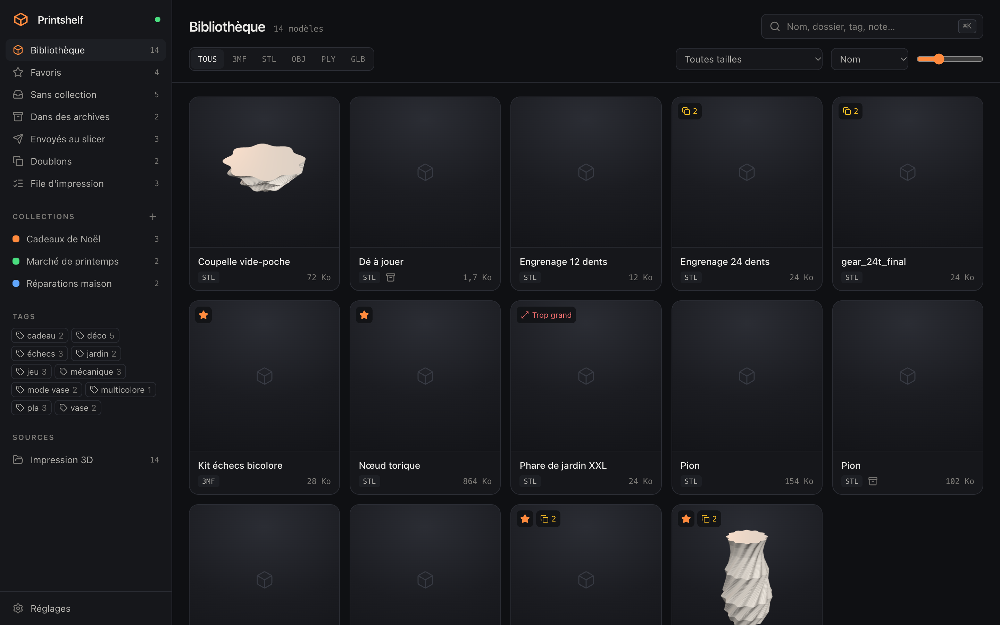
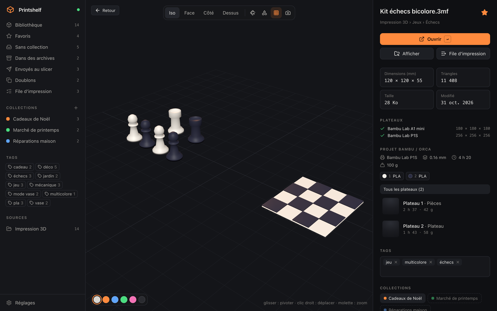
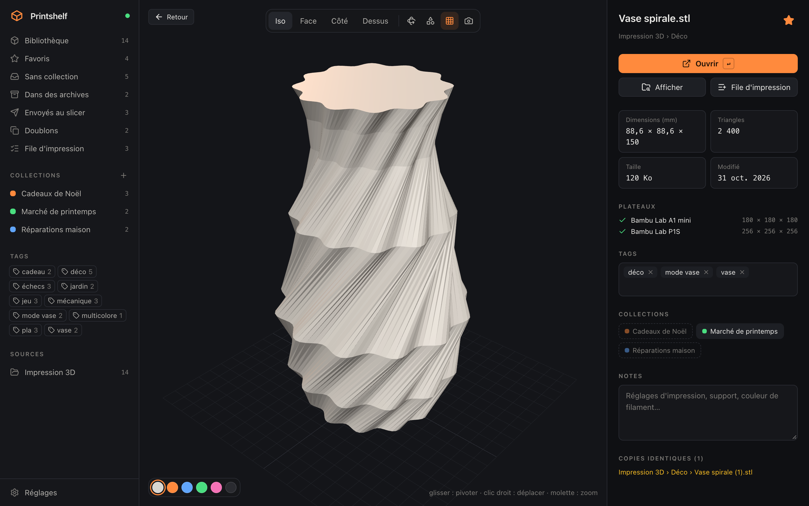
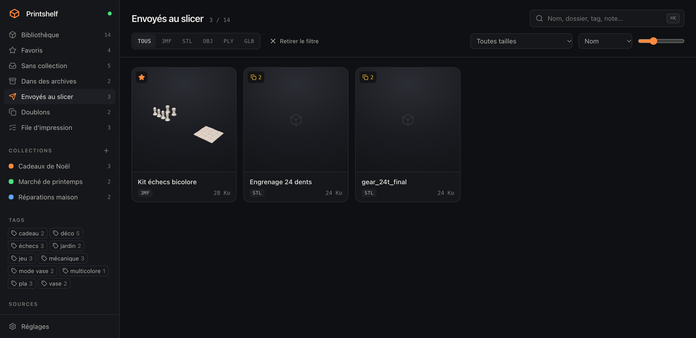
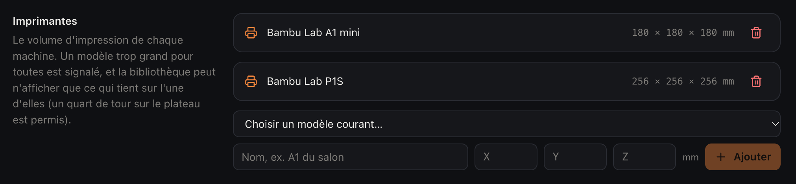
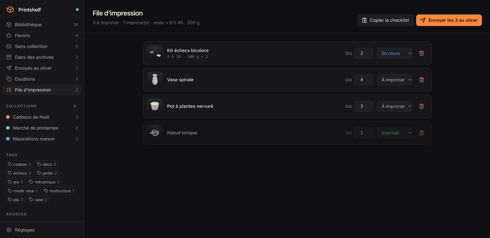
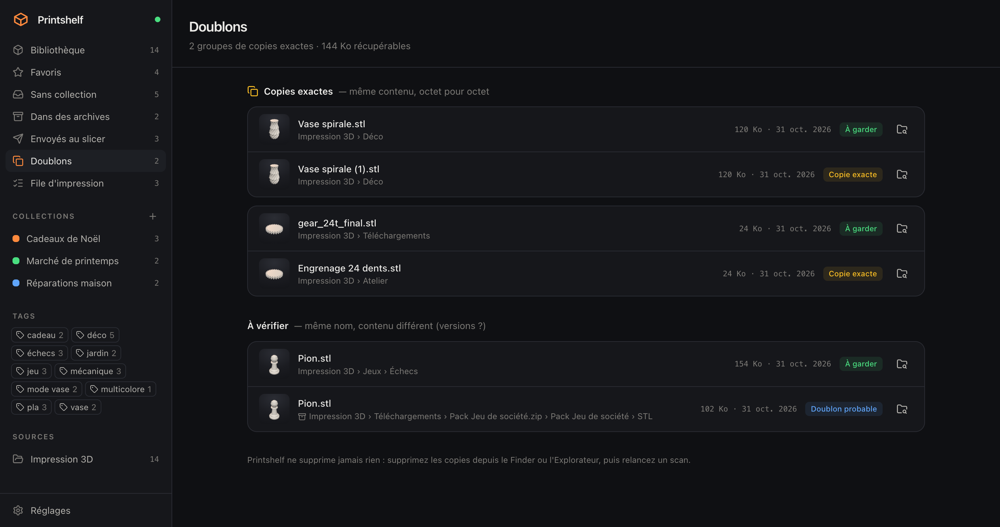

<div align="center">


# Printshelf

**Votre bibliothèque de modèles 3D, prête à partir au slicer.**

Printshelf range les fichiers `.3mf`, `.stl`, `.obj`, `.ply`, `.glb`, `.step` et `.gcode` que vous avez
déjà — archives ZIP, RAR et 7z comprises — les affiche en miniatures, les ouvre en 3D, et les envoie à votre slicer en un geste.
Tout reste sur votre ordinateur : rien n'est déplacé, renommé ni envoyé en ligne.




</div>

---

## Pourquoi

Les modèles s'accumulent : téléchargements Printables et MakerWorld, packs Patreon en ZIP, projets Bambu
Studio à plusieurs plateaux, copies renommées `dragon (1).stl`… Retrouver le bon fichier, savoir s'il tient
sur son imprimante et l'ouvrir dans le bon slicer prend plus de temps que l'impression ne le mérite.

Printshelf indexe les dossiers où vos fichiers sont **déjà**, et fait de chaque modèle une fiche prête à
imprimer.

## Fonctionnalités

### Une bibliothèque qui se voit

- **Une miniature pour chaque modèle** — celle enregistrée par le slicer dans le 3MF (Bambu Studio,
  OrcaSlicer, PrusaSlicer), sinon un rendu 3D fait sur place puis mis en cache.
- **Archives parcourues comme des dossiers** : ZIP lu sans extraction, RAR et 7z via le `tar` du système.
- **STEP et G-code** : pièces de CAO ouvertes en 3D dans le navigateur ; aperçu des trajets d'un G-code
  et sa miniature intégrée (PrusaSlicer, Bambu Studio, Orca).
- **Recherche instantanée** (`⌘K` / `Ctrl+K`) dans les noms, dossiers, tags et notes ; filtres par format,
  source, collection, tag ; favoris, « sans collection », « dans des archives ».
- **Collections et tags** pour regrouper sans déplacer un seul fichier, avec des **tags suggérés** tirés
  des dossiers et du nom du fichier, et des **actions groupées** sur une sélection (`⌘`/`Ctrl`-clic,
  `Maj`-clic) : tag, collection, favori, créateur et page d'origine.
- **Grille virtualisée** : fluide même sur des dizaines de milliers de modèles.
- **Surveillance des dossiers** : un modèle téléchargé apparaît tout seul.

### Inspecter avant de trancher



- **Visionneuse 3D** : rotation, zoom, vues Iso / Face / Côté / Dessus, rotation automatique, filaire,
  capture PNG.
- **Projets Bambu Studio / OrcaSlicer lus en détail** : imprimante, hauteur de couche, **filaments et leurs
  couleurs** (la visionneuse les applique pièce par pièce), **plateaux** affichables un par un, et pour un
  projet tranché, **durée et poids** par plateau.
- **Fichiers joints** : rendus, notices PDF et readme rangés à côté du modèle (ou dans le pack ZIP), ouverts
  d'un clic.
- **Créateur et source** : titre, créateur, licence, description et page d'origine sont lus dans les 3MF
  (MakerWorld, Bambu Studio, PrusaSlicer) et dans les readme / LICENSE des packs (Thingiverse, Printables,
  MakerWorld, Cults3D, MyMiniFactory). Vous pouvez les compléter ; la recherche trouve un modèle par son
  créateur, et « Tous les modèles de… » regroupe ses créations.



### Du navigateur à la bibliothèque

L'**extension « Enregistrer dans Printshelf »** (Chrome, Edge, Brave, Firefox) range chaque modèle que vous
téléchargez sur Printables, MakerWorld, Thingiverse, Cults3D ou MyMiniFactory : le fichier est copié dans votre
bibliothèque avec l'image de la page, son créateur, sa description et le lien d'origine. Installation en
quatre clics : [`extension/README.md`](extension/README.md).

### Du dossier au slicer en un geste

- **Ouvrir dans le slicer** : Bambu Studio, OrcaSlicer, PrusaSlicer, Cura, Creality Print, Lychee… sont
  détectés automatiquement.
- **Plusieurs modèles d'un coup** : sélectionnez, appuyez sur `Entrée` — ils arrivent ensemble, sur le même
  plateau. `Entrée` fonctionne aussi depuis la fiche d'un modèle.
- **Le bon slicer automatiquement** : un slicer par défaut, et des règles par tag (« résine » → Lychee).
- **Envoyés au slicer** : retrouvez ce que vous avez imprimé la semaine dernière pour le relancer.



### Ça rentre sur mon plateau ?

Déclarez vos imprimantes (les modèles courants sont proposés) : chaque modèle est **mesuré** en tâche de
fond, un badge signale ce qui est **trop grand** pour toutes, et le filtre **« Tient sur… »** ne garde que ce
qui passe — un quart de tour sur le plateau est pris en compte.



### Préparer une série

La **file d'impression** liste ce qu'il reste à imprimer (un marché, des cadeaux…), avec quantités, statut,
**durée et filament estimés** pour les projets tranchés, une checklist à copier et un bouton pour **tout
envoyer au slicer**.



### Faire le ménage

Le **détecteur de doublons** regroupe les copies exactes — y compris dans les archives — suggère celle à
garder et la place récupérable, retrouve **le même modèle dans deux fichiers différents** (un STL et son 3MF :
même nombre de triangles, mêmes dimensions, même pivoté) et signale les doublons probables (même nom,
contenu différent).
Printshelf ne supprime jamais rien lui-même.



### Sur tous vos ordinateurs

Choisissez un dossier déjà synchronisé (iCloud Drive, Dropbox, OneDrive, Google Drive…) — le même sur
chaque machine : **tags, notes, favoris, créateurs et liens d'origine, collections, file d'impression, imprimantes et règles
de slicer** vous suivent. Ils sont rattachés au **contenu** des fichiers, pas à leur chemin : ils retrouvent leur modèle même
s'il est rangé ailleurs sur l'autre ordinateur. Aucun serveur, aucun compte.
Détails : [`docs/synchronisation.md`](docs/synchronisation.md).

## Installation

**Prérequis** : [Node.js](https://nodejs.org) 24 ou plus.

```shell
git clone https://github.com/Suissehide/Printshelf.git
cd Printshelf
```

Puis :

- **macOS** : double-cliquez sur `start.command`.
  Pour une vraie application dans le Dock, lancez une fois `macos/creer-app.command` : elle crée
  `Printshelf.app` dans `~/Applications` et propose le lancement à l'ouverture de session.
- **Windows** : double-cliquez sur `start.bat`.
  Pour une icône sur le Bureau, lancez une fois `windows/creer-raccourci.bat` : le raccourci « Printshelf »
  peut aussi être épinglé à la barre des tâches, et le script propose le lancement au démarrage de Windows.
- **Linux / terminal** :
  ```shell
  npm --prefix back install && npm --prefix front install && npm --prefix front run build
  npm --prefix back start
  ```

Printshelf s'ouvre sur **http://localhost:4747**. Ajoutez vos dossiers dans **Réglages → Sources** : c'est
tout. Au premier lancement, les dépendances s'installent et l'interface est construite (une à deux minutes).
Après un `git pull`, relancez simplement : le lanceur reconstruit l'interface (en terminal, refaites les
deux commandes).

### Formats

| Type | Formats |
| --- | --- |
| Modèles (miniature, visionneuse, mesure) | `.3mf` · `.stl` · `.obj` · `.ply` · `.glb` (non mesuré) |
| CAO et impression (miniature, visionneuse) | `.step` / `.stp` · `.gcode` |
| Archives parcourues | `.zip` · `.rar` · `.7z` (via `tar` : macOS, Windows 10+ ; Linux : `libarchive-tools`) |
| Fichiers joints | `.jpg` · `.png` · `.webp` · `.gif` · `.pdf` · `.txt` · `.md` |
| Réglages de slicer lus | Bambu Studio, OrcaSlicer, PrusaSlicer (`.3mf`) |

## Installation serveur (optionnelle)

Pour un NAS ou un VPS qui détient lui-même les fichiers, `deploy/` fournit une stack **Docker Compose**
derrière Traefik et une variante **Dokploy**. Les modèles sont montés en **lecture seule** ; l'accès est
protégé par mot de passe (HTTPS obligatoire) et limité au domaine déclaré ; « Ouvrir dans le slicer » y
devient « Télécharger ».

```shell
cp deploy/.env.example deploy/.env      # domaine, dossier des modèles, mot de passe
docker network create proxy             # une fois, réseau partagé avec Traefik
cd deploy && docker compose up -d --build
```

## Développement

| Dossier | Contenu |
| --- | --- |
| `back/` | API Node/Fastify en TypeScript (Zod, SQLite intégré à Node `node:sqlite`, aucune base à installer). Guide : [`back/CLAUDE.md`](back/CLAUDE.md) |
| `front/` | React 19 + Vite, TanStack Router/Query/Virtual, Tailwind 4, three.js. Guide : [`front/CLAUDE.md`](front/CLAUDE.md) |
| `extension/` | Extension de navigateur (Manifest V3, JavaScript sans build) |
| `deploy/` | Docker Compose + Traefik, Dokploy |
| `docs/` | Notes de conception, captures, [bibliothèque de démonstration](docs/demo/README.md) |

```shell
npm --prefix back install && npm --prefix front install
npm --prefix back run dev     # API sur http://localhost:4747 (données dans back/data)
npm --prefix front run dev    # interface sur http://localhost:4271, /api relayé vers le back
```

Dans `back/` comme dans `front/` : `npm test`, `npm run build` (typage), `npm run lint`. La CI GitHub
Actions les lance à chaque push.

## Feuille de route

- [x] Archives RAR et 7z
- [x] Doublons par géométrie (le même modèle en STL et en 3MF)
- [x] STEP et aperçu du G-code
- [x] Icône dans le Dock / sur le Bureau, lancement au démarrage
- [ ] Tags et recherche par IA, avec votre propre clé
- [ ] G-code binaire (`.bgcode`) et arcs G2/G3 dans l'aperçu

Idées et rapports de bug bienvenus dans les [issues](../../issues).

## Contribuer

1. Forkez, créez une branche.
2. Gardez les tests, le typage et le lint au vert dans `back/` et `front/`.
3. Ouvrez une pull request en décrivant le besoin et comment vous l'avez vérifié.

## Licence

[MIT](LICENSE) — utilisez, modifiez, partagez.
